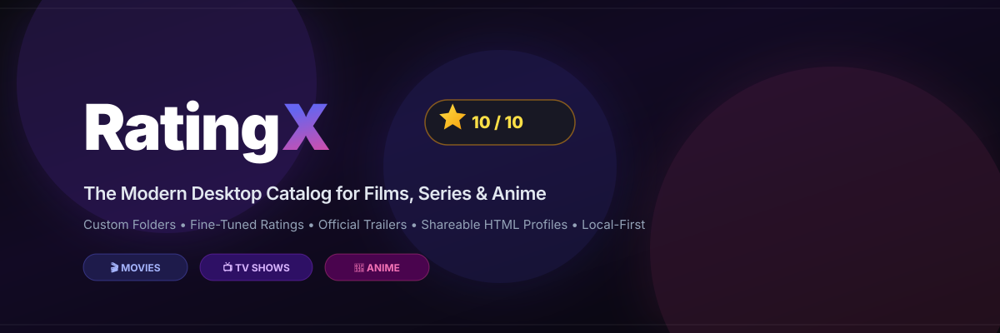

<div align="center">



<br/><br/>

[](https://github.com/davCreate/RatingX/releases/latest)
[](https://github.com/davCreate/RatingX/releases/latest)
[](https://www.electronjs.org/)
[](LICENSE)

<br/>

**Discover, curate, and rate films, TV series, and anime with precision on a 0.0 to 10.0 scale.**<br/>
*Built with React 18, TypeScript, Tailwind CSS, Framer Motion, and packaged natively for Windows.*

<br/>

[📥 **Download Windows Installer (.exe)**](https://github.com/davCreate/RatingX/releases/download/v1.0.0/RatingX.Setup.1.0.0.exe) &nbsp;&bull;&nbsp; [⚡ **Download Portable Standalone (.exe)**](https://github.com/davCreate/RatingX/releases/download/v1.0.0/RatingX-Portable-1.0.0.exe) &nbsp;&bull;&nbsp; [📦 **All Releases**](https://github.com/davCreate/RatingX/releases)

</div>

---

## 📸 Overview

RatingX gives entertainment lovers a distraction-free, local-first catalog. Track seasonal anime, Hollywood blockbusters, and indie series in one unified dashboard without paywalls or forced accounts.

```
+---------------------------------------------------------------------------------------+
|  RatingX                                                                              |
|  +----------------+  +-------------------------------------------------------------+  |
|  | [Home]         |  |  ★ 10 / 10 Masterpiece Rating Scale                         |  |
|  | [Explore]      |  |                                                             |  |
|  | [All Titles]   |  |  [ Trending Movies ] [ Popular Shows ] [ Top Anime ]        |  |
|  | [Favorites]    |  |                                                             |  |
|  | [Profile]      |  |  +---------+   +---------+   +---------+   +---------+      |  |
|  |                |  |  | Poster  |   | Poster  |   | Poster  |   | Poster  |      |  |
|  | FOLDERS:       |  |  | 9.8★    |   | 10.0★   |   | 9.2★    |   | 8.9★    |      |  |
|  | ▶ Watching     |  |  +---------+   +---------+   +---------+   +---------+      |  |
|  | ⭐ Completed    |  |                                                             |  |
|  | 🔖 Plan to Watch|  |  Rating Distribution:  10★ [████████]  9★ [██████]  ...      |  |
|  | 🔥 Masterpieces|  +-------------------------------------------------------------+  |
+---------------------------------------------------------------------------------------+
```

---

## ⚡ Key Highlights

### 🔍 Multi-Engine Search & Discovery
- **Live Trending Lists**: High-speed discovery queries for current top anime and trending movies/shows.
- **Unified Catalog**: Simultaneous lookup across TMDB (cinema & series) and Jikan (MyAnimeList anime engine).
- **Genre & Year Filters**: Refine search by Sci-Fi, Dark Fantasy, Action, Mystery, Thriller, Romance, or Shonen.
- **Search Memory**: Instant access to your recent search queries.

### 📁 Custom Sections & Folders
- Create unlimited custom folders (*e.g.*, 🍿 *Binge Watch*, 🔥 *All-Time 10s*, 🌸 *Masterpiece Anime*, ⏳ *Backlog*).
- Personalize each section with custom emoji icons and distinct color accents.
- Move titles between folders instantly.

### ⭐ 0.0 to 10.0 Precision Rating
- **Dual Controls**: Tap star ratings or fine-tune with the decimal slider (*e.g.*, `9.4/10`, `8.7/10`).
- **Speed Presets**: 1-click presets for *10 Masterpiece*, *9.0 Great*, *8.0 Good*, *6.5 Decent*, and *4.0 Weak*.
- **Review Notes**: Keep personal reviews, favorite quotes, and memorable timestamps per title.
- **Custom Tags**: Add hashtags like `#Rewatch`, `#HansZimmer`, `#PlotTwist` to categorize.

### 🎥 In-App Official Trailers
- Watch full HD official trailers directly inside the app with YouTube integration or launch in browser with one click.

### 👤 Public Watch Profile & HTML Export
- Customizable public identity: Avatar, banner, bio, and favorite quote.
- **Interactive Distribution Graph**: Visual bar chart of your score distribution across all titles.
- **Standalone HTML Export**: Generate a self-contained, responsive portfolio webpage of your rated catalog with 1 click to share anywhere.

### 🔄 Auto-Update Checker
- Built-in updater that queries the GitHub releases API on `davCreate/RatingX` to notify of new builds.

### 🎨 Color Themes
- **Obsidian Dark**: Elegant dark violet & slate palette.
- **OLED Pure Black**: High-contrast true black (`#000000`).
- **Cyberpunk Neon**: Electric purple and hot-pink aesthetic.

---

## 📥 Download Executables (Windows)

| Build | File Name | Size | Install Required | Link |
|---|---|---|---|---|
| **Installer** | `RatingX Setup 1.0.0.exe` | ~128 MB | Yes (Desktop + Start Menu shortcuts) | [Download](https://github.com/davCreate/RatingX/releases/download/v1.0.0/RatingX.Setup.1.0.0.exe) |
| **Portable** | `RatingX-Portable-1.0.0.exe` | ~128 MB | No (Standalone run anywhere) | [Download](https://github.com/davCreate/RatingX/releases/download/v1.0.0/RatingX-Portable-1.0.0.exe) |

*System Requirements: Windows 10 or Windows 11 (64-bit).*

---

## ⌨️ Keyboard Shortcuts

| Shortcut | Action |
|---|---|
| `/` | Instantly jump and focus Search bar |
| `Esc` | Close any active modal, trailer, or dialog |
| `F12` | Toggle Developer Tools console |

---

## 🛠️ Architecture & Tech Stack

```
RatingX/
├── electron/
│   └── main.cjs           # Electron main process (window, shortcuts, external links)
├── src/
│   ├── components/        # PosterCard, RatingWidget, RatingChart, TrailerModal, Sidebar
│   ├── pages/             # Home, Search, Library, Profile, Settings
│   ├── services/          # TMDB & Jikan API multi-search and trending engine
│   ├── store/             # Zustand persistent state (library, profile, folders, theme)
│   └── types/             # TypeScript data contracts
└── release/               # Compiled Windows .exe binaries
```

- **Runtime**: [Electron 33](https://www.electronjs.org/)
- **Frontend**: [React 18](https://react.dev/) + [TypeScript 5](https://www.typescriptlang.org/)
- **Bundler**: [Vite 5](https://vitejs.dev/)
- **Styling**: [Tailwind CSS 3](https://tailwindcss.com/)
- **Motion**: [Framer Motion 11](https://www.framer.com/motion/)
- **Packaging**: [electron-builder 26](https://www.electron.build/)

---

## 💻 Developer Guide

```bash
# 1. Clone repository
git clone https://github.com/davCreate/RatingX.git
cd RatingX

# 2. Install dependencies
npm install

# 3. Run development mode (Vite live reload)
npm run dev

# 4. Run inside Electron
npm run electron:start

# 5. Compile Windows .exe installer and portable executable
npm run package:win
```

---

## 📄 License

Distributed under the **MIT License**. See [LICENSE](LICENSE) for details.

Maintained with ❤️ by [davCreate](https://github.com/davCreate).
